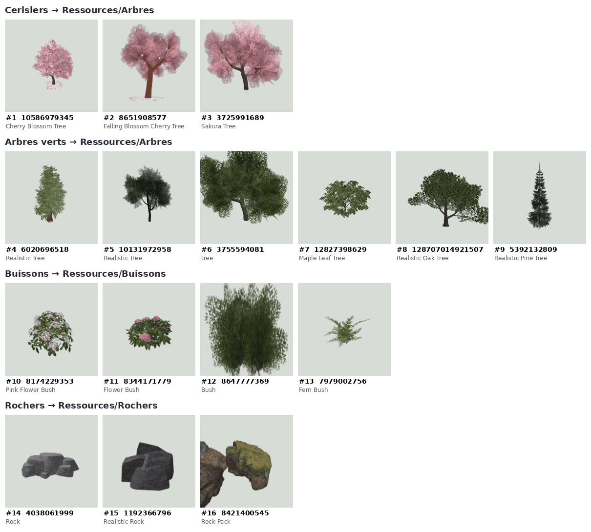

# Les assets : où les trouver gratuitement, et comment s'en servir

Pas besoin d'être graphiste : l'essentiel est déjà réglé par le code et par
le catalogue Roblox. Ce guide dit ce qui est fait, où trouver le reste
gratuitement, et comment l'ajouter au jeu.

## 1. Ce qui est déjà réglé

| Quoi | Comment | Où le changer |
|---|---|---|
| **Oreilles et queues** des coureuses | 10 « robes » (Noir, Bai brun, Alezan, Alezan cuivré, Isabelle, Gris perle, Rose poudré, Framboise, Prune, Bleu nuit), tirées du catalogue Roblox | `src/shared/Robes.luau` |
| **Coiffures** des bots | assorties à leur robe, deux ou trois styles par couleur, catalogue Roblox | `src/shared/Robes.luau` |
| **Tenue** des bots | maillot aux couleurs de leur cadre, collants bleu marine | `src/server/Coureuses.luau` |
| **Ton avatar** | tu cours avec ton propre avatar Roblox, plus les oreilles et la queue de la robe choisie au lobby | — |
| **Terrain** | herbe, collines tout autour, rochers, étang avec plage, taches d'herbe dense | `src/server/Hippodrome.luau` |
| **Hippodrome** | piste, lices, arche, tribune, écran géant, podium, arbres | `src/server/Hippodrome.luau` |
| **Sons** | musiques (Académie, course, podium), ambiance de chaque hippodrome, sifflet du départ, sprint, foule, sons d'interface | `Config.SONS` dans `src/shared/Config.luau` |
| **Chansons du concert** | quatre musiques APM | `Concert.CHANSONS` dans `src/shared/Jeu/Concert.luau` |
| **Décor de l'Académie** | fontaine, arche « Académie des Vents », bancs, parterres de fleurs, panneaux indicateurs, banderoles, kiosque à musique | `src/server/Academie.luau` |

**Pourquoi le catalogue est gratuit ici.** Dans un jeu, on peut habiller
n'importe quel personnage avec un objet public du catalogue (accessoire,
coiffure, vêtement) sans l'acheter. C'est comme ça que fonctionnent les jeux
« catalogue avatar creator ». Ni toi ni les joueurs ne payez quoi que ce soit.

**Si un objet disparaît** (retiré par son créateur ou par la modération), le
jeu ne casse pas : il remet à la place des oreilles et une queue fabriquées
par le code, dans la couleur de la robe.

## 2. Où trouver des assets gratuits

### Dans Roblox Studio : la boutique (Toolbox)

C'est le plus simple, tout est déjà au bon format. Menu **View → Toolbox**.

- **Models** : arbres, rochers, buissons, bâtiments, décors entiers.
- **Audio** : des milliers de musiques et de bruitages **sous licence de
  Roblox** (éditeurs APM, ProSoundEffects…), utilisables gratuitement dans
  tous les jeux. Le bouton ▶ permet d'écouter avant de choisir.
- **Meshes, Images, Plugins**.

Trois règles pour les modèles gratuits :

1. **Créateur vérifié** (badge bleu) et beaucoup de votes positifs.
2. **Jamais dans ServerScriptService.** Un modèle gratuit peut cacher un
   script malveillant (une « backdoor ») qui donne le contrôle du jeu à
   quelqu'un d'autre.
3. **Passe le contrôle** `tools/studio/controle-modeles.lua` après chaque
   insertion (voir [CE-SOIR.md](CE-SOIR.md)). De son côté, le jeu retire
   tout script des modèles qu'il pose à partir de `ServerStorage.Ressources`.

### Sélection déjà vérifiée pour Stellar Derby

Tous de créateurs vérifiés, bien notés, gratuits et **sans aucun script**.
Pour les trouver : Toolbox → Models → coller le numéro dans la recherche, ou
ouvrir `https://create.roblox.com/store/asset/<numéro>`.

| # | Dossier de dépôt | Modèle | Numéro | Créateur | Votes |
|---:|---|---|---|---|---|
| 1 | `Ressources/Arbres` | Cherry Blossom Tree (cerisier) | 10586979345 | TheLunar_Mothz | 1 000, 98 % |
| 2 | `Ressources/Arbres` | Falling Blossom Cherry Tree | 8651908577 | softlypoetic | 100, 96 % |
| 3 | `Ressources/Arbres` | Sakura Tree (cerisier) | 3725991689 | plentune | 2 000, 96 % |
| 4 | `Ressources/Arbres` | Realistic Tree (feuillu clair) | 6020696518 | Adrijan0830 | 1 000, 97 % |
| 5 | `Ressources/Arbres` | Realistic Tree (feuillu sombre) | 10131972958 | Mrwalter87 | 1 000, 97 % |
| 6 | `Ressources/Arbres` | tree (grand feuillu) | 3755594081 | Astrooworlld | 700, 92 % |
| 7 | `Ressources/Arbres` | Maple Leaf Tree (érable) | 12827398629 | 2FuriousDev | 70, 99 % |
| 8 | `Ressources/Arbres` | Realistic Oak Tree (chêne) | 128707014921507 | Letaij | 40, 93 % |
| 9 | `Ressources/Arbres` | Realistic Pine Tree (sapin) | 5392132809 | GabeQZ | 100, 97 % |
| 10 | `Ressources/Buissons` | Pink Flower Bush | 8174229353 | Unlimitens | 400, 97 % |
| 11 | `Ressources/Buissons` | Flower Bush | 8344171779 | Woof_HDPlay | 300, 95 % |
| 12 | `Ressources/Buissons` | Bush | 8647777369 | Seespotbyte | 2 000, 93 % |
| 13 | `Ressources/Buissons` | Fern Bush (fougère) | 7979002756 | TheLegoGuy137 | 70, 96 % |
| 14 | `Ressources/Rochers` | Rock | 4038061999 | FinisMaps | 800, 94 % |
| 15 | `Ressources/Rochers` | Realistic Rock | 1192366796 | woahitsdylx | 1 000, 94 % |
| 16 | `Ressources/Rochers` | Rock Pack (rochers moussus) | 8421400545 | RedWood Roleplay GROUP | 80, 98 % |

Conseils :

- **Deux ou trois arbres suffisent**, par exemple un cerisier et deux
  feuillus verts. Le jeu les répartit au hasard et règle lui-même leur
  taille, quelle que soit celle du modèle d'origine.
- **Un pack** (comme le n° 16) arrive parfois en un seul bloc de plusieurs
  objets. Posé tel quel, il fait un groupe de rochers ; pour des rochers
  isolés, sors-les du pack un par un dans le dossier.
- Les mêmes cerisiers circulent sous plusieurs noms (« Sakura Park Tree »,
  « Japanese Sakura Tree »…) : ce sont des copies du n° 1, inutile de les
  ajouter en plus.

**Écartés à ta demande** (style low-poly, anguleux) : Low Poly Tree
4893246329, Low-Poly Tree 3287226226, Low poly pine tree 5616880673, Classic
Rock 5314247866. Le cerisier 12800074855 n'est pas dans la liste non plus : il
contient deux scripts.

Les sons déjà choisis : bibliothèque sous licence de Roblox (APM Music,
ProSoundEffects) et sons de Roblox lui-même, gratuits pour tous les jeux.
Chaque numéro a été vérifié le 23 octobre 2026 avec l'API de la Toolbox
(éditeur et durée).

| Moment | Clé dans `Config.SONS` | Titre | Éditeur | Numéro |
|---|---|---|---|---|
| À l'Académie (en boucle) | `musiqueAcademie` | Peaceful Day Ukulele | APM | 1839580585 |
| Pendant la course | `musiqueCourse` | Here Comes The Winner 2 | APM | 1845636153 |
| Podium | `fanfare` | Victory Fanfare | APM | 1836490503 |
| Ambiance de l'Archipel | `ambianceArchipel` | Birds Peaceful 2 | ProSoundEffects | 9113444532 |
| Ambiance de la Baie | `ambianceBaie` | Waves Long Rolling In Constantly Heavy Surf | ProSoundEffects | 9126201834 |
| Ambiance des Falaises | `ambianceFalaises` | Desert Wind Whistley Light Gusts 2 | ProSoundEffects | 9114057128 |
| Ouverture des stalles | `partez` | Referee Whistle Interior Gymnasium 1 | ProSoundEffects | 9118114334 |
| Ton sprint | `sprint` | Rising Whoosh Hissing Build Up Ascending | ProSoundEffects | 9125805579 |
| Arrivée de la gagnante | `foule` | Crowd Cheer And Applause 1 | ProSoundEffects | 9112766176 |
| Clic d'un bouton | `clic` | Roblox_UI_Small_Click | Roblox | 15675032796 |
| Gain d'étoiles | `gain` | CoinTransfer_01 | Roblox | 127645268874265 |
| Niveau atteint | `niveau` | Short Fanfare | APM | 1846266827 |
| Nouveau titre | `titre` | Synth Sparkle Tone High Pitch Bell Tone Ding | ProSoundEffects | 9126073001 |

Les chansons du concert de la victoire (dans `src/shared/Jeu/Concert.luau`) :

| Chanson du jeu | Morceau | Éditeur | Numéro |
|---|---|---|---|
| Étoiles de la piste | Upbeat Pop (Kosinus) | APM | 1839763308 |
| Cœur au galop | Cheerful Pop (Kosinus) | APM | 1839766271 |
| Lumière d'arrivée | Tonight All Right E (Hermann Langschwert) | APM | 1847760598 |
| Rêve d'archipel | Dream Within A Dream C (Hideyuki Asada) | APM | 1845976243 |

Je ne les ai pas écoutés (pas de son ici) : écoute-les dans la Toolbox et
remplace ceux qui ne te plaisent pas. **Pour remplacer un son** : dans
Studio, Toolbox → onglet Audio, cherche, clic droit sur le son → « Copy
Asset ID », puis colle le numéro dans `Config.SONS` à la place de l'ancien
(garde la forme `"rbxassetid://123456"`). Une chaîne vide coupe ce son.
Pour une chanson du concert, change aussi son `tempo` (battements par
minute) si tu le connais : la partition du jeu de rythme le suit.

### Sur le site Roblox : le catalogue d'avatar

[roblox.com/catalog](https://www.roblox.com/catalog) : accessoires, coiffures
et vêtements. Pour changer une oreille, une queue ou une coiffure, ouvre
l'objet et copie le numéro de son adresse
(`roblox.com/catalog/123456789/...`) dans `src/shared/Robes.luau`.

**Attention aux objets au nom d'un personnage d'Uma Musume** (« Special
Week », « Tokai Teio »…) : ce sont des créations de fans qui utilisent une
marque protégée, et ils peuvent être retirés à tout moment. Ceux qu'on
utilise portent des noms génériques (« Horse Ears », « Horse Tail »).

### Plus tard, pour un style unique : les sites de ressources libres

Ces sites proposent des modèles 3D, des textures et des sons qu'on peut
utiliser gratuitement, même dans un jeu qui rapporte de l'argent :

| Site | Contenu | Licence |
|---|---|---|
| [Kenney](https://kenney.nl/assets) | interfaces, icônes, sons (ses modèles 3D sont low-poly) | CC0 : tout permis, rien à citer |
| [Poly Haven](https://polyhaven.com) | textures, ciels, modèles réalistes | CC0 |
| [ambientCG](https://ambientcg.com) | textures (herbe, terre, sable…) | CC0 |
| [Freesound](https://freesound.org) | bruitages | **à vérifier son par son** : CC0, ou CC-BY (il faut alors citer l'auteur) |
| [OpenGameArt](https://opengameart.org) | de tout | **à vérifier objet par objet** |

Pour les faire entrer dans Roblox :

- **Modèles 3D** (.fbx, .obj, .gltf) : Studio → **File → Import 3D**.
- **Images et textures** : Studio → **Asset Manager → Import**. Une texture
  d'herbe peut devenir un `MaterialVariant` pour la piste.
- **Sons** : Asset Manager, ou create.roblox.com. Les envois de sons sont
  limités chaque mois.

## 3. Deux règles de Roblox à connaître

- **Animations** : un jeu ne peut jouer que les animations de Roblox ou
  celles qui appartiennent au créateur du jeu (toi ou ton groupe). Une
  animation gratuite trouvée dans la Toolbox doit donc être republiée sous
  ton compte. Stellar Derby utilise les animations par défaut de Roblox,
  autorisées partout.
- **Sons** : seuls les sons publics de la bibliothèque Roblox, ou ceux que tu
  envoies toi-même, sont jouables dans ton jeu.

## 4. Les licences, en résumé

| Licence | Ce qu'on peut faire | Ce qu'on doit faire |
|---|---|---|
| **CC0** | tout, même vendre | rien |
| **CC-BY** | tout, même vendre | citer l'auteur (un écran « Crédits ») |
| **CC-BY-NC** | usage non commercial seulement | à éviter si le jeu vend des cosmétiques |
| **Boutique Roblox** | l'utiliser dans un jeu Roblox | rien |
| **Catalogue Roblox** | en habiller les personnages du jeu | rien |
